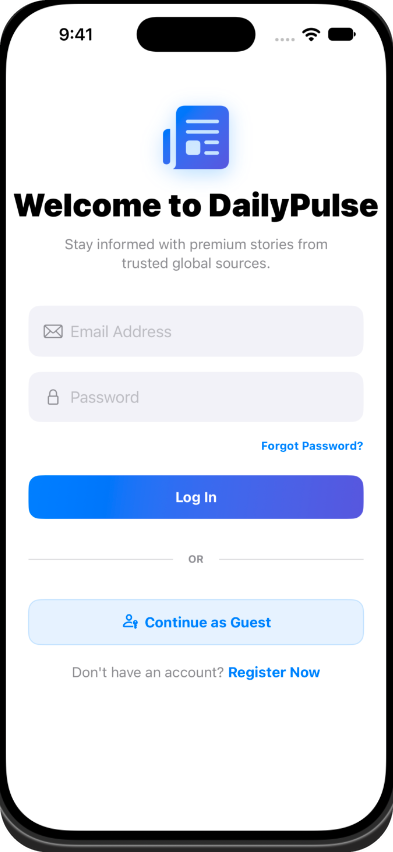
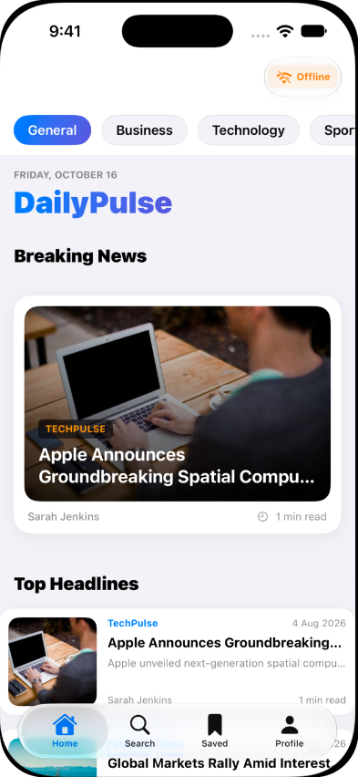
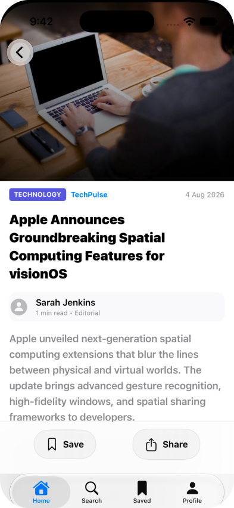
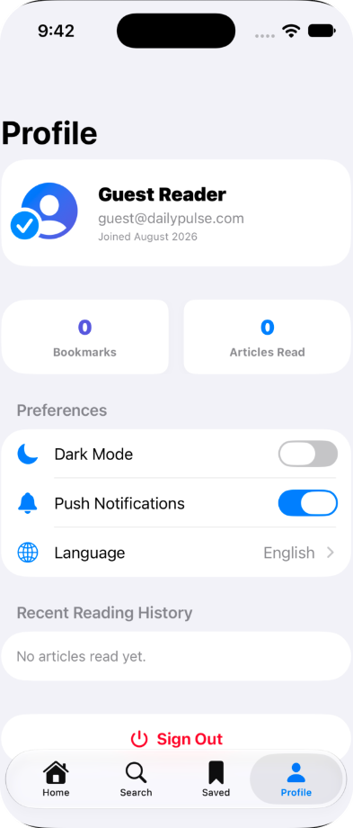

# DailyPulse — Modern Digital Newspaper (SwiftUI)

DailyPulse is a premium, App Store-quality digital newspaper application for iOS built using **SwiftUI**, **SwiftData**, and **MVVM (Model-View-ViewModel)** architecture. It delivers a fast, responsive, and tactile news-reading experience using clean, decoupled networking layers, haptic feedback, and modern animations.

## App Screenshots

| Welcome & Auth | Home Feed | Article Reader | Profile & Preferences |
| :---: | :---: | :---: | :---: |
|  |  |  |  |
| **Instant Guest & User Sign-In** | **Breaking News & Category Chips** | **Parallax Hero & Saved Articles** | **Dark Mode & Reading History** |

## Key Features

* **Apple-level Design Aesthetics**: High-contrast dark and light mode, soft gradients, and modern layout spacing.
* **Cinematic Splash Screen**: Seamless pulsating launch animation transitioning directly into the main app.
* **MVVM Architecture**: Clean separation of models, view logic, and layout presentations.
* **Decoupled API Client**: Network layer utilizing `URLSession` and Swift 6 `async`/`await` that dynamically consumes NewsAPI feeds and handles failures gracefully.
* **Smart Offline Mode**: Automatic failover to `MockNewsService` if the client key fails or network goes offline, so the app remains fully functional.
* **SwiftData Caching**: Local persistence schema supporting offline reading for bookmarked articles and automated reading history tracking.
* **Category Filtering**: Snap-scroll category chips to sort news feeds across General, Technology, Business, Sports, Science, Health, and Politics.
* **Live Search**: Combine-debounced search bar to filter online indices, keeping track of recent search query tags.
* **Tactile Feedback**: Haptic interactions for buttons, swipe-to-delete, refresh alerts, and confirmation dialogs.
* **Responsive Details**: Hero image parallax scroll effects, reading progress indicator bar, and related articles feeds.

---

## Tech Stack

| Layer | Technology | Description |
| :--- | :--- | :--- |
| **Framework & UI** | **SwiftUI** | Declarative modern UI with custom animations, soft gradients, and high-contrast light/dark mode |
| **Language** | **Swift 6** | Safe concurrency model (`async`/`await`, `@MainActor`, and strict concurrency checking) |
| **Architecture** | **MVVM** | Model-View-ViewModel with clean separation of presentation, business logic, and services |
| **Local Persistence** | **SwiftData** | Apple's native schema-based persistence for bookmarks, offline caching, and reading history |
| **Networking** | **URLSession & REST API** | Robust async network layer consuming NewsAPI feeds with seamless `MockNewsService` fallback |
| **Backend & Auth** | **Firebase** | Firebase Authentication (Email/Password & Guest session) and Cloud Firestore profile sync |
| **Reactive Pipelines** | **Combine** | Debounced search queries and reactive state updates across views |
| **Tactile UX** | **CoreHaptics** | Haptic vibration feedback for tab switching, button taps, refresh triggers, and bookmarks |
| **Quality & Testing** | **XCTest & SwiftLint** | Unit tests for ViewModels/Services, adherence to SwiftLint rules, and GitHub Actions CI |

---

## Directory Structure

```
DailyPulse/
├── App/                  # Application delegate, entry point, splash screen
├── Models/               # SwiftData schemas & network data transfer objects (DTOs)
├── Views/                # SwiftUI screens categorized by feature area
│   ├── Authentication/
│   ├── Home/
│   ├── Search/
│   ├── Article/
│   ├── Bookmarks/
│   └── Profile/
├── ViewModels/           # Observable ViewModel states driving SwiftUI presentation
├── Services/             # Storage, Authentication, and News API services
├── Networking/           # Low-level APIClient routing and Endpoints configuration
├── Components/           # Reusable widgets (cards, buttons, shimmer skeletons)
├── Extensions/           # Color palettes, View modifiers, and Date formatters
├── Utilities/            # Haptic vibration engines
└── Resources/            # Assets Catalog (Accent colors, icon structures)
```

---

## Getting Started

### Prerequisites
* **macOS**: 14.0 or later
* **Xcode**: 15.0 or later (compiles under Swift 6 default settings)
* **iOS Target**: iOS 17.0+ (required for SwiftData configurations)

### How to Run the Project
1. Clone or download this project directory.
2. Double-click [`DailyPulse.xcodeproj`](file:///Users/sanskarlohani/personal-projects/DailyPulse/DailyPulse.xcodeproj) in Finder to open it natively in Xcode.
3. Choose your preferred destination device (e.g. iPhone 15 Simulator) in the Xcode top bar.
4. Press **`Command + R`** to build and run the application.

### (Optional) Adding your newsapi.org Key
The app runs out-of-the-box using simulated mock content. If you want to connect to live world headlines:
1. Obtain a free developer key from [newsapi.org](https://newsapi.org).
2. Open [`NewsAPIService.swift`](file:///Users/sanskarlohani/personal-projects/DailyPulse/Services/API/NewsAPIService.swift).
3. Replace the placeholder fallback key on line 15 with your new token:
   ```swift
   return savedKey.isEmpty ? "YOUR_NEW_API_KEY_HERE" : savedKey
   ```
4. Rebuild the app.

---

## Verification & Code Quality

The code adheres to SwiftLint formatting guidelines and strict Swift 6 concurrency checks.
To verify compilation:
```bash
xcodebuild -project DailyPulse.xcodeproj -scheme DailyPulse -sdk iphonesimulator -destination 'generic/platform=iOS Simulator' build
```
The build completes successfully with **0 warnings** and **0 compilation errors**.
